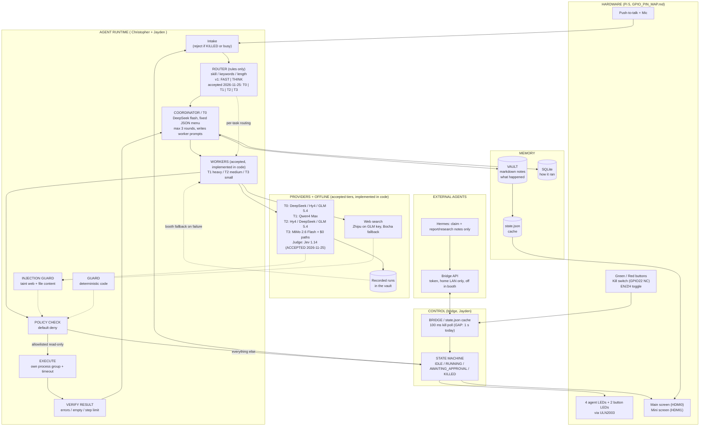
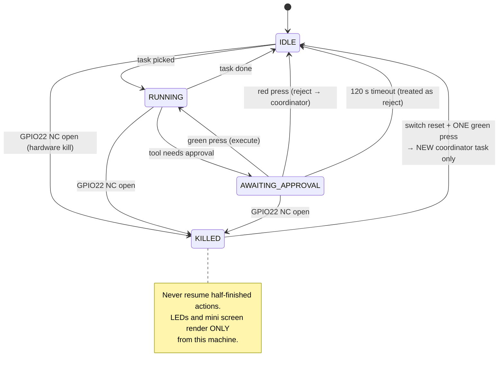
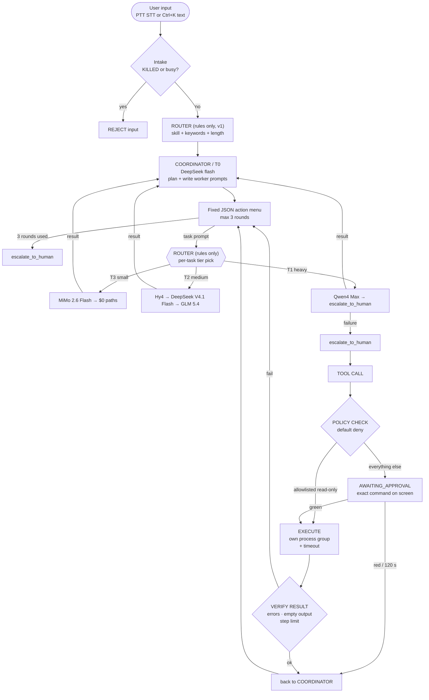
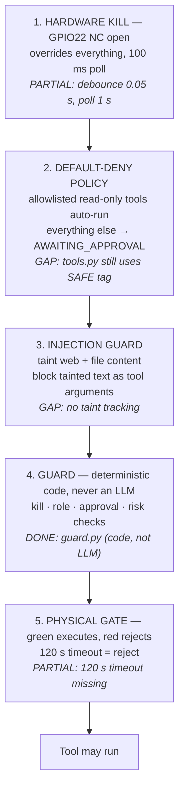
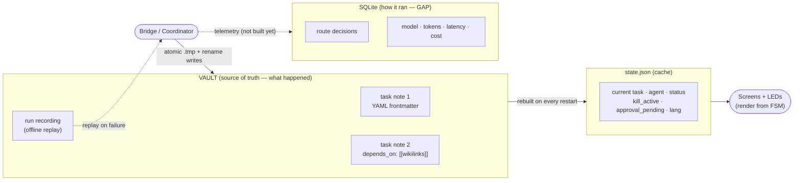
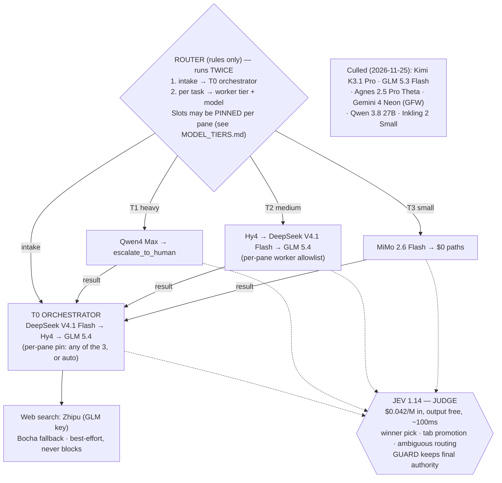
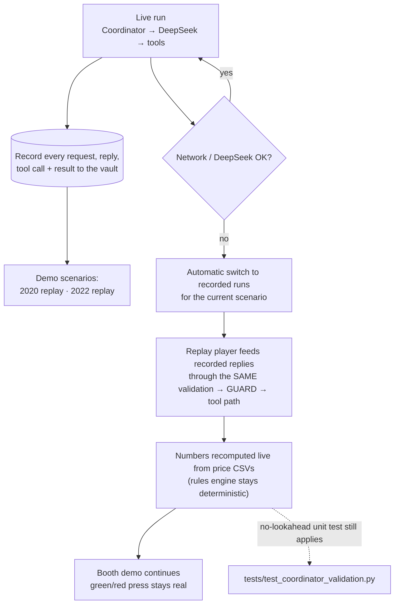
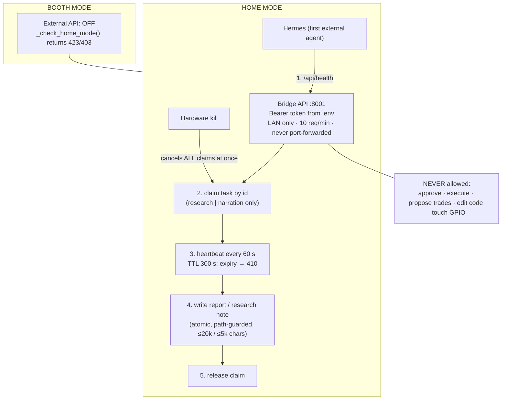
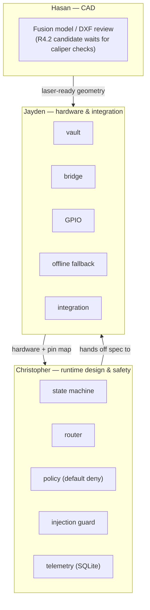
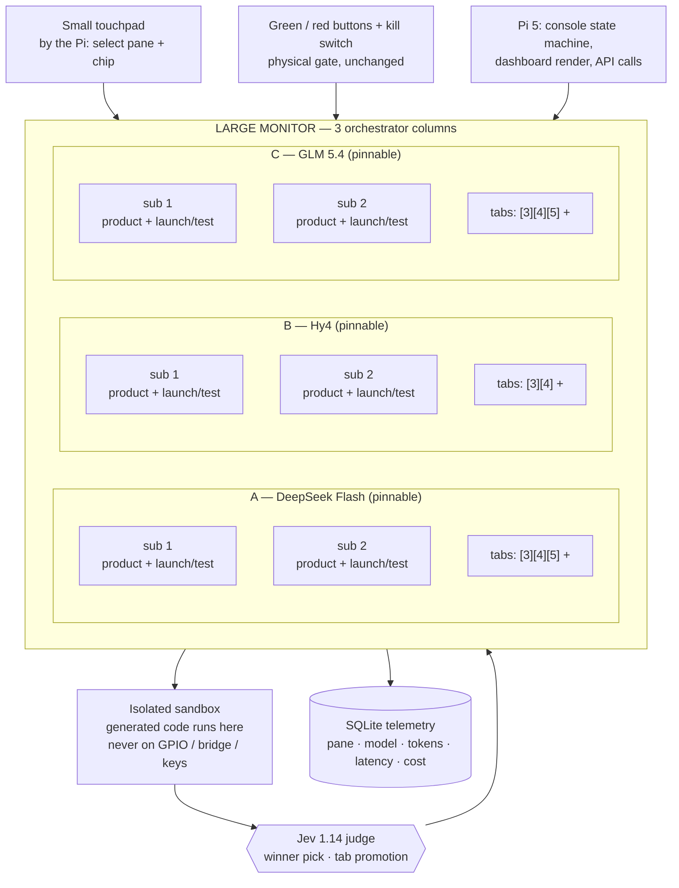

# SI Console — Architecture Visualizations

Companion to `docs/ARCHITECTURE.md` (the authoritative v1 spec).
Date 2026-11-23, tier diagrams updated 2026-11-25. This document only
visualizes; it does not change the spec. The four-tier roster shown in diagrams
1, 3 and 6 is ACCEPTED (2026-11-25) in `docs/MODEL_TIERS.md`, but is not yet
implemented in the v1 skeleton.

Each diagram is Mermaid, so it renders on GitHub and in most Markdown viewers.
A legend after each diagram maps the parts to the spec section and to the
current `code/` skeleton: **DONE** (already implemented and tested),
**PARTIAL** (some of it exists), **GAP** (not implemented yet). Read
`docs/ARCHITECTURE.md` → "Implementation gaps" for the authoritative list.

---

## 1. Big picture — the whole system

**Legend:** hardware and bridge are **PARTIAL** (real GPIO, buttons, LEDs, bridge
API exist; the 100 ms poll and explicit FSM do not). Intake/router/policy/
injection guard/execute/verify are **GAP**. Coordinator is **PARTIAL** (menu,
3-round limit, GUARD exist; no `escalate_to_human` action). Vault is **DONE** as
truth with `state.json` rebuilt from it; SQLite telemetry is **GAP**. DeepSeek +
web search (Zhipu on the GLM key, Bocha fallback) are **DONE**; offline recording/replay is **GAP**. External-agent API is
**DONE / aligned** (home-mode, rate limit, claim types).

The four-tier worker roster is **ACCEPTED 2026-11-25** (see
`docs/MODEL_TIERS.md`) and the chains, pane pins, Jev tie-break and SQLite
telemetry are **implemented in `code/` (2026-11-24, mocked tests only)**;
the coordinator's worker-dispatch action and the arena runner/UI are still
GAP. The v1 spec text still names FAST/THINK and DeepSeek-only — updating it
is the owners' call. Spec sections: STATE MACHINE, FLOW, SAFETY, MEMORY AND
STATE, PROVIDERS, OFFLINE, EXTERNAL AGENTS.

---

## 2. State machine (Christopher, authoritative)

**Legend:** the explicit machine is a **GAP**. Today the skeleton uses tasks with
frontmatter status `queued → working → blocked/done`, an `approval_pending` flag,
and a `kill_active` flag in `state.json` — LEDs read those fields directly. The
kill-reset path is **PARTIAL**: the bridge clears `kill_active` on reset + green
press (I fixed the release-state bug), but there is no explicit `KILLED` state or
"new task only" enforcement. Spec section: STATE MACHINE.

---

## 3. End-to-end flow (the main loop)

**Legend:** the coordinator skeleton has the **PARTIAL** pieces (fixed
12-action menu, 3-round limit → escalation note, validation, GUARD check, an
approval *pause* that only logs). Router, tiered workers (the T1/T2/T3 chains
shown are **ACCEPTED 2026-11-25** — see `docs/MODEL_TIERS.md` — but not
implemented), one-escalation, default-deny policy, exact-command display,
process-group execution and result verification are **GAP**. Spec sections:
FLOW, SAFETY, STATE MACHINE.

---

## 4. Safety stack (the five layers)

**Legend:** GUARD is **DONE** — it is code, has no LLM, cannot be talked out of a
block, and I recently synced kill state into it so a kill reaches the coordinator.
The hardware kill *circuit* is real (normally closed, fail-safe) but the **100 ms
poll is a GAP**. Default-deny and the injection taint guard are **GAPs**. The
physical gate is **PARTIAL**. Spec section: SAFETY.

---

## 5. Memory and state — three stores, three jobs

**Legend:** vault + atomic note writes + `state.json` rebuild on start are
**DONE** (`vault.py`, `state_store.py`, 89 passing tests). `[[wikilinks]]` in the
body is **PARTIAL** (parser reads them; creation from the model is skeleton).
Run recordings and SQLite telemetry are **GAP**. Spec sections: MEMORY AND
STATE, OFFLINE.

---

## 6. Providers and routing (who calls whom)

**Legend:** all four tier chains are **ACCEPTED 2026-11-25** (recorded in
`docs/MODEL_TIERS.md`) and are **implemented in `code/` (2026-11-24)**:
`config.py` chains + pane pins, `chat_client.py` (one OpenAI-compatible client
for DeepSeek, Hunyuan/Hy4, GLM, Bailian/Qwen, MiMo), `models.py` chain walk with
fallback and T1 `EscalationNeeded`, `router.py` rules with Jev tie-break,
`judge.py` (Jev direct from TypeSafe, Qwen on Bailian HK as backup) and `telemetry.py` (SQLite). **213 mocked
tests pass; no live provider call has been made** — wire shapes are unconfirmed, taken from
docs and model ids go in `code/.env`. Still GAP: a worker-dispatch action in the
coordinator's fixed menu and live verification per provider. No Anthropic
client, deliberately, because the booth is in Shenzhen. Web search (Zhipu on the GLM key since 2026-11-26, Bocha as fallback) is **DONE** as a
best-effort search that never blocks and never changes a ranking. Jev 1.14 is
the accepted **judge** — typed decisions in ~100ms, output free — not the old
optional home-only shadow advisor (Inkling was culled). GLM 5.4 is benchmarked
(KingBench 4) and the
5.3 Flash interim note is CLOSED. Spec section: PROVIDERS.

---

## 7. Offline fallback (booth must work without internet)

**Legend:** everything here is **GAP** except the deterministic rules engine
(**DONE**, with a no-lookahead test). There is no recording mode in
`deepseek_client.py` yet and no replay player. The design principle — replay
through the *same* validation and GUARD path so approval never gets skipped — is
documented in the architecture gaps table. Spec section: OFFLINE.

---

## 8. External agents (home only)

**Legend:** **DONE / aligned** — `bridge.py` already has home-mode gating, the
rate limit, `CLAIMABLE_TYPES = {research, narration}`, token checks, and
`state_store.py` implements claim TTL/heartbeat/release-all-on-kill. The API is
documented as off in booth mode; no further work needed for this section. Spec
section: EXTERNAL AGENTS.

---

## 9. Ownership map

**Legend:** ownership matches the spec. The pin map has one source,
`docs/GPIO_PIN_MAP.md`; the code and the R5 wiring diagram agree with it
(reconciled 2026-11-24).

---

## 10. Booth arena demo (ACCEPTED 2026-11-25, runner/UI not built)

**Legend:** this is the accepted 2026-11-25 booth demo design recorded in
`docs/MODEL_TIERS.md` §"Booth arena". The **route/model layer is implemented**
(2026-11-24): per-pane pins, T2 allowlists, T1 on/off, Jev tie-break, SQLite
telemetry, 213 mocked tests. The **arena contest runner, the 3-column UI, the
tab-chip promotion flow and the isolated sandbox are GAP** — not built. When
built, the Pi will render the dashboard and make API calls; generated code will
run only in the sandbox, never on the GPIO/bridge path. Green/red/kill remain
the physical gate. Each column keeps 2 main subagents on stage with extra
agents as tab chips. Spec sections: PROVIDERS, SAFETY (sandbox is outside
GUARD's physical-action scope by design).

---

## Cross-reference index

| Diagram | Spec section | Implementation status |
|---|---|---|
| 1. Big picture | all | mixed — see per-node legend |
| 2. State machine | STATE MACHINE | GAP |
| 3. End-to-end flow | FLOW, SAFETY | PARTIAL |
| 4. Safety stack | SAFETY | mixed (GUARD DONE, others GAP/PARTIAL) |
| 5. Memory and state | MEMORY AND STATE, OFFLINE | PARTIAL / GAP |
| 6. Providers and routing | PROVIDERS | DONE in code (4 tiers + Jev with Qwen backup, 213 mocked tests); live calls unverified, check with `python -m si_console.smoke --live` |
| 7. Offline fallback | OFFLINE | GAP (rules engine DONE) |
| 8. External agents | EXTERNAL AGENTS | DONE / aligned |
| 9. Ownership map | OWNERSHIP | informational |
| 10. Booth arena demo | PROVIDERS, SAFETY | route/model layer DONE (mocked); runner/UI/sandbox GAP |

Rendering notes: Mermaid should be supported by GitHub natively. If a viewer
does not render `stateDiagram-v2` or ` ` labels, the equivalent text is in
`docs/ARCHITECTURE.md`, which remains the single source of truth.
