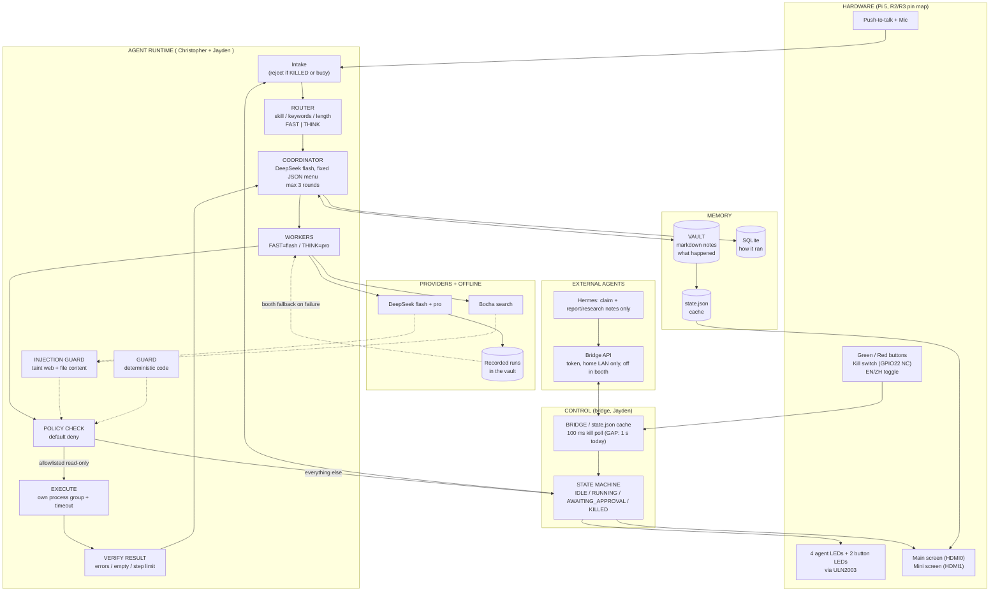
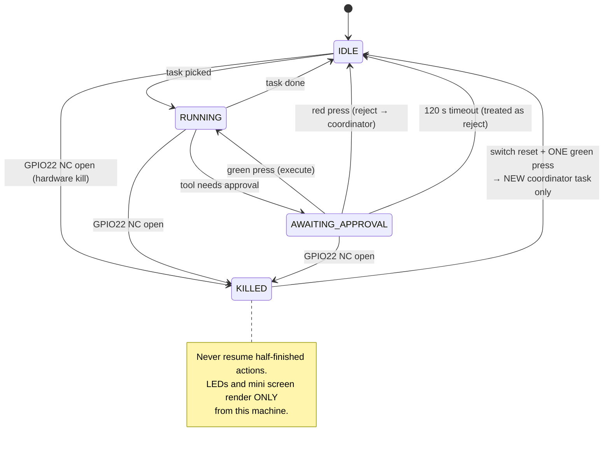
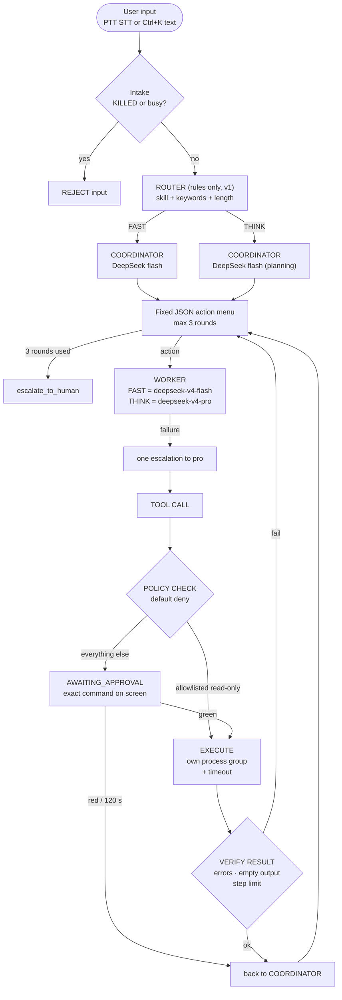
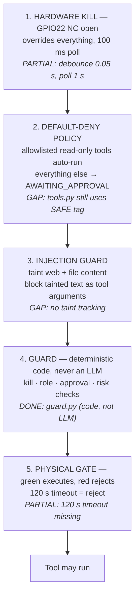
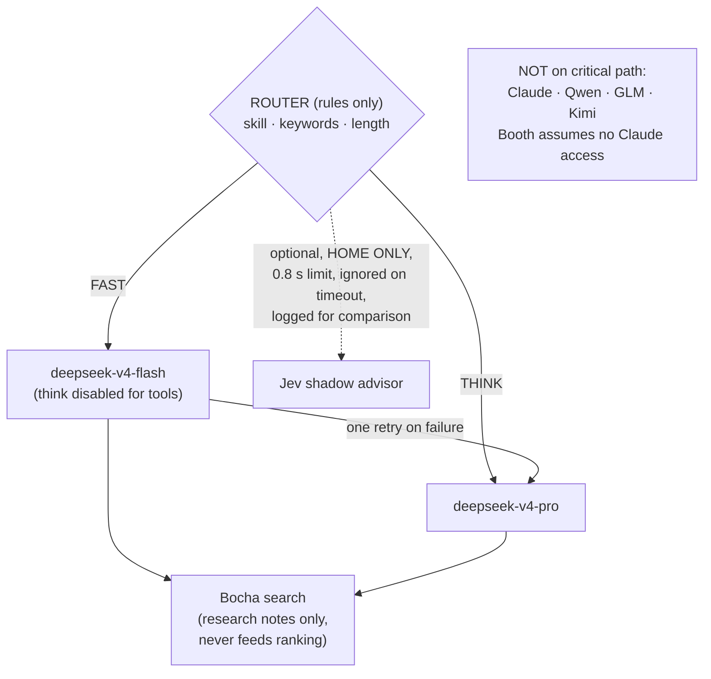
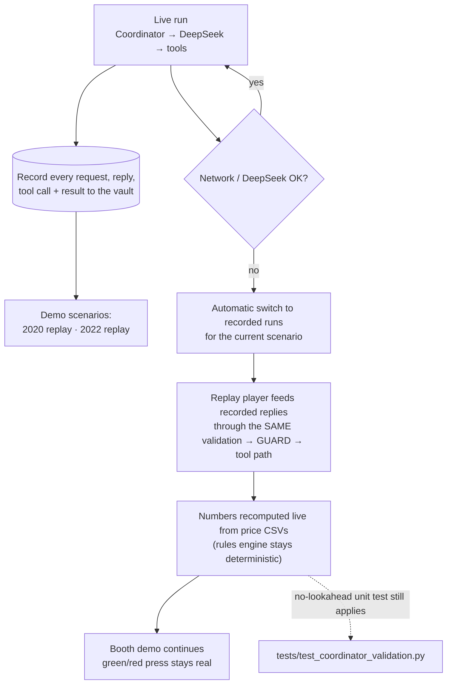
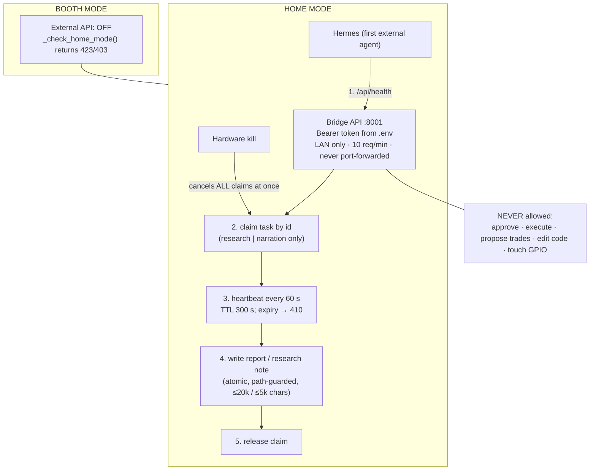
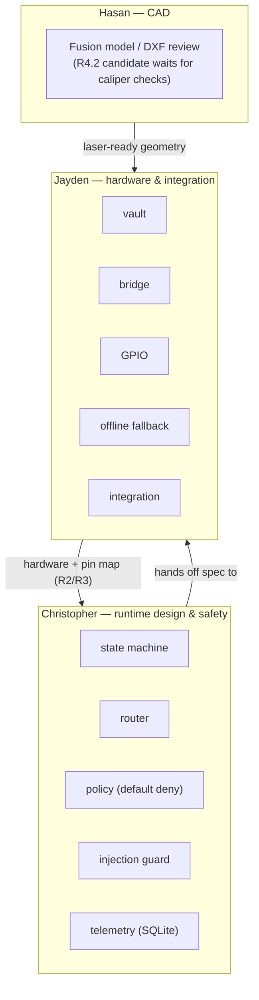

# SI Console — Architecture Visualizations

Status: DRAFT companion to `docs/ARCHITECTURE.md` (the authoritative spec).
Date 2026-11-23. This document only visualizes; it does not change the spec.

Each diagram is Mermaid, so it renders on GitHub and in most Markdown viewers.
A legend after each diagram maps the parts to the spec section and to the
current `code/` skeleton: **DONE** (already implemented and tested),
**PARTIAL** (some of it exists), **GAP** (not implemented yet). Read
`docs/ARCHITECTURE.md` → "Implementation gaps" for the authoritative list.

---

## 1. Big picture — the whole system

**Legend:** hardware and bridge are **PARTIAL** (real GPIO, buttons, LEDs, bridge
API exist; the 100 ms poll and explicit FSM do not). Intake/router/policy/
injection guard/execute/verify are **GAP**. Coordinator is **PARTIAL** (menu,
3-round limit, GUARD exist; no `escalate_to_human` action). Vault is **DONE** as
truth with `state.json` rebuilt from it; SQLite telemetry is **GAP**. DeepSeek +
Bocha are **DONE**; offline recording/replay is **GAP**. External-agent API is
**DONE / aligned** (home-mode, rate limit, claim types).

Spec sections: STATE MACHINE, FLOW, SAFETY, MEMORY AND STATE, PROVIDERS,
OFFLINE, EXTERNAL AGENTS.

---

## 2. State machine (Christopher, authoritative)

**Legend:** the explicit machine is a **GAP**. Today the skeleton uses tasks with
frontmatter status `queued → working → blocked/done`, an `approval_pending` flag,
and a `kill_active` flag in `state.json` — LEDs read those fields directly. The
kill-reset path is **PARTIAL**: the bridge clears `kill_active` on reset + green
press (I fixed the release-state bug), but there is no explicit `KILLED` state or
"new task only" enforcement. Spec section: STATE MACHINE.

---

## 3. End-to-end flow (the main loop)

**Legend:** the coordinator skeleton has the **PARTIAL** pieces (fixed
12-action menu, 3-round limit → escalation note, validation, GUARD check, an
approval *pause* that only logs). Router, tiered workers, one-pro-escalation,
default-deny policy, exact-command display, process-group execution and result
verification are **GAP**. Spec sections: FLOW, SAFETY, STATE MACHINE.

---

## 4. Safety stack (the five layers)

**Legend:** GUARD is **DONE** — it is code, has no LLM, cannot be talked out of a
block, and I recently synced kill state into it so a kill reaches the coordinator.
The hardware kill *circuit* is real (normally closed, fail-safe) but the **100 ms
poll is a GAP**. Default-deny and the injection taint guard are **GAPs**. The
physical gate is **PARTIAL**. Spec section: SAFETY.

---

## 5. Memory and state — three stores, three jobs

**Legend:** vault + atomic note writes + `state.json` rebuild on start are
**DONE** (`vault.py`, `state_store.py`, 89 passing tests). `[[wikilinks]]` in the
body is **PARTIAL** (parser reads them; creation from the model is skeleton).
Run recordings and SQLite telemetry are **GAP**. Spec sections: MEMORY AND
STATE, OFFLINE.

---

## 6. Providers and routing (who calls whom)

**Legend:** DeepSeek-only is **DONE** in `models.py` + `deepseek_client.py`
(the router fails closed to DeepSeek; there is no Anthropic client — deliberately,
because the booth is in Shenzhen). Bocha is **DONE** as a best-effort search that
never blocks and never changes a ranking. The **rules-based tier router** and the
**one-time pro escalation** are **GAP**; today tiers are chosen by caller name
(coordinator/worker/narration/premium). Jev shadow advisor is **GAP / optional**.
Spec section: PROVIDERS.

---

## 7. Offline fallback (booth must work without internet)

**Legend:** everything here is **GAP** except the deterministic rules engine
(**DONE**, with a no-lookahead test). There is no recording mode in
`deepseek_client.py` yet and no replay player. The design principle — replay
through the *same* validation and GUARD path so approval never gets skipped — is
documented in the architecture gaps table. Spec section: OFFLINE.

---

## 8. External agents (home only)

**Legend:** **DONE / aligned** — `bridge.py` already has home-mode gating, the
rate limit, `CLAIMABLE_TYPES = {research, narration}`, token checks, and
`state_store.py` implements claim TTL/heartbeat/release-all-on-kill. The API is
documented as off in booth mode; no further work needed for this section. Spec
section: EXTERNAL AGENTS.

---

## 9. Ownership map

**Legend:** ownership matches the spec. One open conflict is shown in the
diagram set: the spec says the pin map is R2/R3 only, but `docs/GPIO_PIN_MAP.md`
now also carries a dated R4.1 section — flagged in `ARCHITECTURE.md`'s gaps table
for the two owners to reconcile.

---

## Cross-reference index

| Diagram | Spec section | Implementation status |
|---|---|---|
| 1. Big picture | all | mixed — see per-node legend |
| 2. State machine | STATE MACHINE | GAP |
| 3. End-to-end flow | FLOW, SAFETY | PARTIAL |
| 4. Safety stack | SAFETY | mixed (GUARD DONE, others GAP/PARTIAL) |
| 5. Memory and state | MEMORY AND STATE, OFFLINE | PARTIAL / GAP |
| 6. Providers and routing | PROVIDERS | PARTIAL / GAP |
| 7. Offline fallback | OFFLINE | GAP (rules engine DONE) |
| 8. External agents | EXTERNAL AGENTS | DONE / aligned |
| 9. Ownership map | OWNERSHIP | informational |

Rendering notes: Mermaid should be supported by GitHub natively. If a viewer
does not render `stateDiagram-v2` or ` ` labels, the equivalent text is in
`docs/ARCHITECTURE.md`, which remains the single source of truth.
